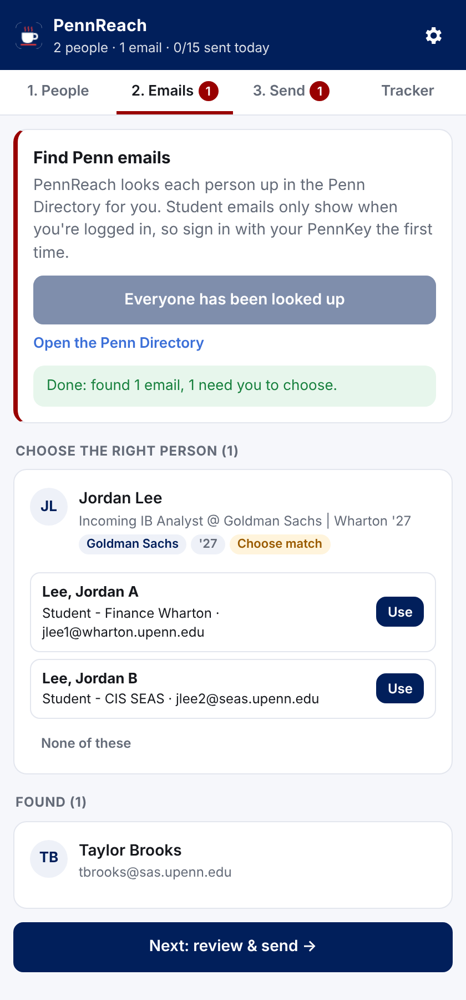
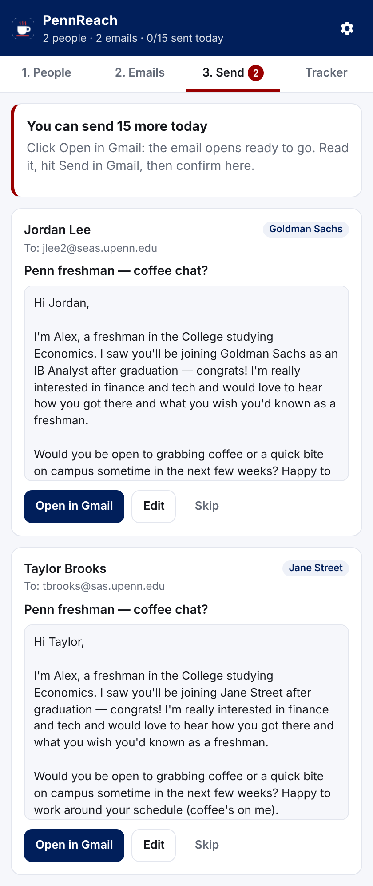
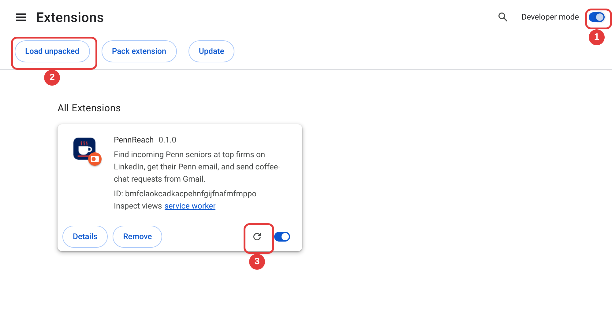
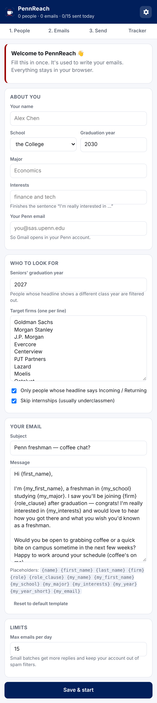

# PennReach ☕

A Chrome extension for Penn freshmen. It finds **incoming seniors at top firms** on LinkedIn, looks up their **Penn email** in the Penn Directory, and helps you send each one a short, personal note asking to grab coffee. Everything happens in a side panel, with no terminal and no setup beyond installing it.

<p align="center">
  
  
  
</p>

## How it works

1. **People:** search LinkedIn as you normally would. PennReach saves everyone on your screen and keeps only people who are *incoming* at a firm on your list and in the senior class.
2. **Emails:** click **Find emails**. PennReach searches the Penn Directory for each person in your logged-in tab. When two people share a name, you pick the right one.
3. **Send:** each person gets an email written from your template. Click **Open in Gmail**, read it, hit Send, then confirm in PennReach.
4. **Tracker:** see who you've emailed, mark replies and coffee chats, and send a follow-up after a few days.

## Install (about 5 minutes)

### Before you start
You'll need:
- **Google Chrome** on a Mac or Windows computer. Other Chrome-based browsers (Arc, Brave, Edge) work too; Safari and Firefox don't.
- A **LinkedIn** account.
- Your **PennKey**, to log in to the Penn Directory.
- Your **Penn Gmail**, the account you send email from.

> School-managed computers sometimes block step 3 below. If you can't turn on Developer mode, use your personal computer.

### Step 1: Download PennReach
1. Open the [**latest release**](../../releases/latest).
2. Scroll down to **Assets** (click the word "Assets" if the list is closed).
3. Click **`PennReach-v….zip`** (for example `PennReach-v0.1.0.zip`) to download it.
   > ⚠️ **Don't** download "Source code (zip)". That's the developer version, and Chrome will reject it.

### Step 2: Unzip it into a folder that will stay put
- **Mac:** open your **Downloads** folder and double-click the zip. A folder called `PennReach-v0.1.0` appears next to it.
- **Windows:** open your **Downloads** folder, **right-click** the zip, choose **Extract All…**, then **Extract**. Double-clicking only *previews* a zip on Windows, and Chrome can't use that.

Then **move that folder somewhere permanent,** such as **Documents**. Chrome loads PennReach from this folder every time it starts, so don't delete or move it later.

### Step 3: Add it to Chrome
1. In Chrome, click the address bar, type `chrome://extensions`, and press **Enter**.
2. Turn on **Developer mode** with the switch in the top-right corner **(1)**.
3. Click **Load unpacked** **(2)**. In the window that opens, find the `PennReach-v0.1.0` folder from Step 2, click it once, and click **Select** (Mac) or **Select Folder** (Windows).
4. A **PennReach** card appears. You can ignore the **(3)** reload button until you update.

<p align="center"></p>

### Step 4: Pin it and open it
1. Click the **puzzle-piece** icon to the right of Chrome's address bar.
2. Find **PennReach** and click the **pin** next to it. A navy **coffee-cup** icon now stays in your toolbar.
3. Click the **coffee cup**. PennReach opens in a panel on the right side of the window.
4. Fill in the one-time setup (your name, school, major, Penn email) and click **Save & start**. You're ready! Continue with [Using it](#using-it).

<p align="center"></p>

### If something goes wrong
| What you see | What to do |
|---|---|
| "Manifest file is missing or unreadable" | You picked the wrong folder or downloaded "Source code". Choose the folder that contains `manifest.json` directly, unzipped from **`PennReach-v….zip`** (Steps 1–2). |
| You can't find **Developer mode** or **Load unpacked** | Make sure you're at `chrome://extensions` in Chrome itself. On a school-managed computer, these may be blocked. |
| The coffee cup isn't in the toolbar | Click the puzzle-piece icon and pin PennReach (Step 4). |
| Chrome says "Disable developer mode extensions" | This can appear when Chrome starts. Close the message with ✕ or choose to keep the extension. Don't click "Disable". |
| PennReach vanished after you moved or deleted the folder | Put the folder back, or go to `chrome://extensions` and use **Load unpacked** again with the folder's new location. |
| LinkedIn pages aren't being collected | Use LinkedIn's **People** search results (not "All"). Scroll down so the results load, then reload the LinkedIn tab once. |
| **Find emails** says you're not logged in | In the Penn Directory tab, click **Log in** at the top and sign in with your PennKey, then click **Find emails** again. |
| Gmail opens in the wrong account | In PennReach Settings (⚙️), enter your Penn email. Also make sure you're signed in to your Penn Gmail in this Chrome profile. |

### Updating to a new version
Your people, emails and settings are kept when you update. Just don't remove the extension.
1. Optional backup: in PennReach, go to **Tracker → Export CSV**.
2. Download and unzip the new `PennReach-v….zip` (Steps 1–2).
3. Open your existing PennReach folder (the one from Step 2), **delete everything inside it**, and drag in everything from the new folder.
4. Go to `chrome://extensions` and click the **↻ reload** button on PennReach's card **(3)**.

> ⚠️ **Never click "Remove"** on PennReach's card unless you want to erase everything it has saved.

## Using it

### 1. People
- Click **Open LinkedIn search** and add LinkedIn's **School** filter (University of Pennsylvania).
- Click through the result pages. A small "PennReach: +8 people" message confirms each page was saved.
- Matches appear in the panel. People who don't match (no "Incoming", not a target firm, interns, other class years) go under **Filtered out**, with the reason. Click **Keep** to add one anyway.
- To pause collecting, turn off **Auto-collect**.

### 2. Emails
- Click **Find emails**. The first time, PennReach opens the Penn Directory: click **Log in** at the top and sign in with your PennKey. Then click **Find emails** again.
- Leave the directory tab open while it runs. It takes about 4 seconds per person.
- **Choose the right person** appears when several students share a name. Click **Use** next to the right one.
- **Couldn't find automatically** lets you paste an email yourself, or skip that person.

### 3. Send
- Each card shows the finished email. Use **Edit** to change it for that person, or **Skip**.
- **Open in Gmail** opens a new email in your Penn Gmail with the recipient, subject and message filled in. Hit Send in Gmail, then click **Yes, sent ✓** in PennReach.
- You can send up to 15 a day by default (change it in Settings). Small batches get more replies.

### Tracker
- Mark **They replied** or **Coffee booked**.
- **Follow up** appears after 5 days without a reply and opens a short, friendly nudge in Gmail.
- **Don't contact** makes sure you never email that person again.

### Settings (⚙️)
Your details, the senior class year, the list of target firms (one per line), and your email template. The template's placeholders, like `{first_name}`, `{firm}` and `{my_major}`, are listed under the message box.

## Privacy

- **Everything stays in your browser.** People, emails and settings are saved in Chrome's local storage for the extension. Nothing is sent to any server. Tracker → **Export CSV** makes a backup, and Settings → **Delete all data** wipes it.
- **It only acts on pages you open.** PennReach reads LinkedIn search results already on your screen; it never clicks, scrolls or pages for you. It searches the directory only when you click **Find emails**, one person at a time.
- **You send every email yourself,** from your own Gmail.

## Etiquette & policy (please read)

- **Keep it personal and low-volume.** Fifteen thoughtful emails get more coffee chats than 150 generic ones. Edit the template so it sounds like you.
- **Follow Penn's rules.** Directory listings "are not to be used for solicitation," and Penn's [acceptable use policy](https://isc.upenn.edu/policies) prohibits bulk harvesting and mass mail. A personal note to a few seniors is fine; a mailing campaign isn't.
- **Follow LinkedIn's terms.** Don't pair PennReach with anything that pages through results automatically.
- **Respect no.** If someone asks you to stop, mark them **Don't contact**.

## For developers

```
extension/
  manifest.json          # Chrome MV3 manifest
  background.js          # opens the side panel from the toolbar icon
  lib/core.js            # headline parsing, filtering, email matching, drafting, CSV (shared + unit-tested)
  lib/store.js           # chrome.storage.local wrapper, one key per person
  content/linkedin.js    # collects people from LinkedIn search results
  content/directory.js   # runs Penn Directory searches in your logged-in tab
  sidepanel/             # the UI
  tests/core.test.js     # unit tests: node --test extension/tests/core.test.js
  tests/e2e.js           # loads the extension in Chromium against mock pages: node extension/tests/e2e.js
pennreach/, bookmarklet/ # the original command-line version, see docs/CLI.md
```

**Releasing:** bump `version` in `extension/manifest.json`, then go to **Actions → Release → Run workflow**, or push a matching tag such as `v0.1.1`. GitHub Actions runs the tests, zips `extension/` and publishes the release.

The end-to-end test needs Playwright with a full Chromium build (`npm i playwright && npx playwright install chromium`). Pass `--screenshots docs/screenshots` to regenerate the screenshots above. All test data uses made-up people.

## License

MIT. See [LICENSE](LICENSE).
