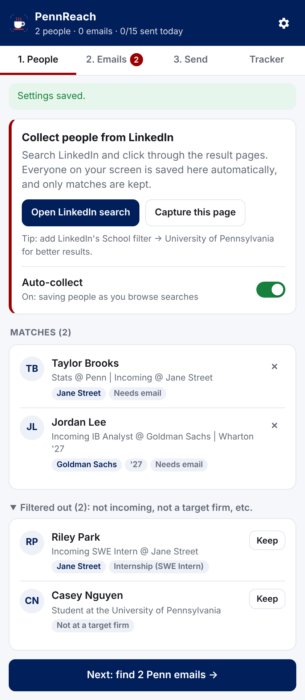

# PennReach ☕

A Chrome extension for Penn freshmen. It finds **incoming seniors at top firms** on LinkedIn, looks up their **Penn email** in the Penn Directory, and helps you send each one a short, personal note asking to grab coffee. Everything happens in a side panel, with no terminal and no setup beyond installing it.

<p align="center">
  
  
  
</p>

## How it works

1. **People:** search LinkedIn as you normally would. PennReach saves everyone on your screen and keeps only people who are *incoming* at a firm on your list and in the senior class.
2. **Emails:** click **Find emails**. PennReach searches the Penn Directory for each person in your logged-in tab. When two people share a name, you pick the right one.
3. **Send:** each person gets an email written from your template. Click **Open in Gmail**, read it, hit Send, then confirm in PennReach.
4. **Tracker:** see who you've emailed, mark replies and coffee chats, and send a follow-up after a few days.

## Install (about 2 minutes)

PennReach isn't in the Chrome Web Store yet, so you install it from a folder:

1. **Download it.** Go to this repo's [**Releases**](../../releases/latest) page and download **PennReach-….zip**. Open the ZIP so you get a folder.
   Move that folder somewhere it can stay, like your Documents folder. Chrome loads PennReach from there.
2. **Open Chrome's extensions page.** Type `chrome://extensions` in the address bar and press Enter.
3. **Turn on Developer mode,** using the switch in the top-right corner.
4. **Click "Load unpacked"** (top left) and choose the folder you just unzipped. It's the one with `manifest.json` inside.
5. **Pin it.** Click the puzzle-piece icon next to the address bar, then the pin next to **PennReach**. The coffee-cup icon now sits in your toolbar.
6. **Click the coffee cup** to open PennReach. Fill in the one-time setup (your name, school, major, Penn email), then click **Save & start**.

> Chrome may show a "Disable developer mode extensions" message when it starts. Click the ✕ to keep PennReach.

**Updating:** download the new ZIP from Releases and replace the files in the same folder. Then click the ↻ reload button on PennReach's card at `chrome://extensions`. Your people and emails are kept. Exporting a backup first doesn't hurt (Tracker → Export CSV).

## Using it

### 1. People
- Click **Open LinkedIn search** and add LinkedIn's **School** filter (University of Pennsylvania).
- Click through the result pages. A small "PennReach: +8 people" message confirms each page was saved.
- Matches appear in the panel. People who don't match (no "Incoming", not a target firm, interns, other class years) go under **Filtered out**, with the reason. Click **Keep** to add one anyway.
- To pause collecting, turn off **Auto-collect**.

### 2. Emails
- Click **Find emails**. The first time, PennReach opens the Penn Directory: click **Log in** at the top and sign in with your PennKey. Then click **Find emails** again.
- Leave the directory tab open while it runs. It takes about 4 seconds per person.
- **Choose the right person** appears when several students share a name. Click **Use** next to the right one.
- **Couldn't find automatically** lets you paste an email yourself, or skip that person.

### 3. Send
- Each card shows the finished email. Use **Edit** to change it for that person, or **Skip**.
- **Open in Gmail** opens a new email in your Penn Gmail with the recipient, subject and message filled in. Hit Send in Gmail, then click **Yes, sent ✓** in PennReach.
- You can send up to 15 a day by default (change it in Settings). Small batches get more replies.

### Tracker
- Mark **They replied** or **Coffee booked**.
- **Follow up** appears after 5 days without a reply and opens a short, friendly nudge in Gmail.
- **Don't contact** makes sure you never email that person again.

### Settings (⚙️)
Your details, the senior class year, the list of target firms (one per line), and your email template. The template's placeholders, like `{first_name}`, `{firm}` and `{my_major}`, are listed under the message box.

## Privacy

- **Everything stays in your browser.** People, emails and settings are saved in Chrome's local storage for the extension. Nothing is sent to any server. Tracker → **Export CSV** makes a backup, and Settings → **Delete all data** wipes it.
- **It only acts on pages you open.** PennReach reads LinkedIn search results already on your screen; it never clicks, scrolls or pages for you. It searches the directory only when you click **Find emails**, one person at a time.
- **You send every email yourself,** from your own Gmail.

## Etiquette & policy (please read)

- **Keep it personal and low-volume.** Fifteen thoughtful emails get more coffee chats than 150 generic ones. Edit the template so it sounds like you.
- **Follow Penn's rules.** Directory listings "are not to be used for solicitation," and Penn's [acceptable use policy](https://isc.upenn.edu/policies) prohibits bulk harvesting and mass mail. A personal note to a few seniors is fine; a mailing campaign isn't.
- **Follow LinkedIn's terms.** Don't pair PennReach with anything that pages through results automatically.
- **Respect no.** If someone asks you to stop, mark them **Don't contact**.

## For developers

```
extension/
  manifest.json          # Chrome MV3 manifest
  background.js          # opens the side panel from the toolbar icon
  lib/core.js            # headline parsing, filtering, email matching, drafting, CSV (shared + unit-tested)
  lib/store.js           # chrome.storage.local wrapper, one key per person
  content/linkedin.js    # collects people from LinkedIn search results
  content/directory.js   # runs Penn Directory searches in your logged-in tab
  sidepanel/             # the UI
  tests/core.test.js     # unit tests: node --test extension/tests/core.test.js
  tests/e2e.js           # loads the extension in Chromium against mock pages: node extension/tests/e2e.js
pennreach/, bookmarklet/ # the original command-line version, see docs/CLI.md
```

**Releasing:** bump `version` in `extension/manifest.json`, then go to **Actions → Release → Run workflow**, or push a matching tag such as `v0.1.1`. GitHub Actions runs the tests, zips `extension/` and publishes the release.

The end-to-end test needs Playwright with a full Chromium build (`npm i playwright && npx playwright install chromium`). Pass `--screenshots docs/screenshots` to regenerate the screenshots above. All test data uses made-up people.

## License

MIT. See [LICENSE](LICENSE).
